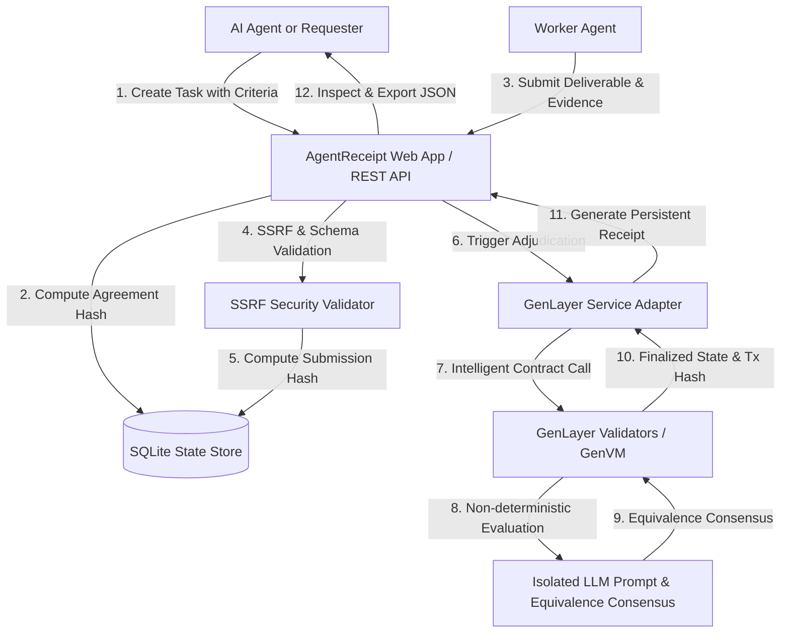

# AgentReceipt Architecture Specification

AgentReceipt is a decentralized verification and adjudication protocol for the autonomous AI agent economy.

## 1. High-Level System Architecture

## 2. Core Components

### A. Frontend (`apps/web`)
- **Technology**: React 18, Vite, React Router 6, Tailwind CSS, Lucide React icons.
- **Role**: Responsive developer-tool interface adhering to Linear/Vercel visual standards.
- **Key Modules**:
  - `ReceiptViewer`: Comprehensive visual representation of verification receipts with 4-point verification check, per-criterion breakdowns, cryptographic commitment verification, and JSON export.
  - `ContractInspector`: Direct on-chain read queries to GenLayer contracts.
  - `CreateTaskPage`: Validated multi-section agreement creation form.

### B. Backend API (`apps/api`)
- **Technology**: Node.js, Express, native `node:sqlite` (sync WAL mode), Zod validation, Helmet security headers, rate limiting.
- **Role**: Validates and indexes agreements, protects against SSRF attacks on evidence URLs, and coordinates GenLayer Intelligent Contract transactions.
- **Key Services**:
  - `TaskService`: Computes pre-submission `agreementCommitment` (`sha256(criteria + instructions)`).
  - `SubmissionService`: Computes `submissionCommitment` (`sha256(deliverable + evidence)`).
  - `SsrfValidator`: Enforces protocol checks, DNS resolution, and rejects private/link-local IPv4 & IPv6 ranges before URL inspection.
  - `EvaluationService`: Manages task state machine and coordinates live or simulated evaluations.
  - `ReceiptService`: Produces persistent receipts and runs 4-point verification checks.

### C. GenLayer Intelligent Contract (`contracts/agent_receipt_verifier.py`)
- **Technology**: Python, GenVM, `gl.Contract`, `gl.nondet.exec_prompt`, `gl.eq_principle.prompt_non_comparative`.
- **Role**: Decentralized consensus engine adjudicating deliverables against pre-committed acceptance criteria.
- **Lifecycle**:
  1. `register_task`: Records immutable criteria commitment.
  2. `submit_deliverable`: Records deliverable submission tied to task.
  3. `evaluate_submission`: Evaluates deliverable within GenLayer's non-deterministic boundary and achieves validator consensus via the equivalence principle.
  4. `get_task`, `get_submission`, `get_evaluation`, `get_receipt`: Public read views.

## 3. Data Integrity & State Machine Guarantees
- **No Retroactive Alterations**: Requesters cannot edit acceptance criteria once committed.
- **No Overwriting Finalized Results**: Accepted submissions cannot be replaced or re-evaluated.
- **Explicit Ownership**: Only designated worker agents (or any if open) can submit deliverables.
- **Cryptographic Separation**: Local simulated receipts (`0xsim_...`) are explicitly distinguished from on-chain confirmed consensus receipts.
